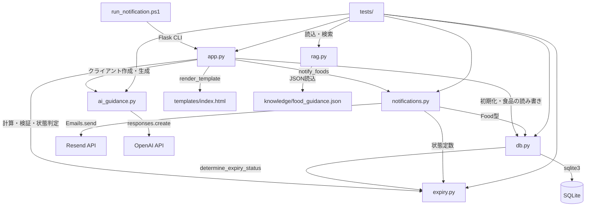
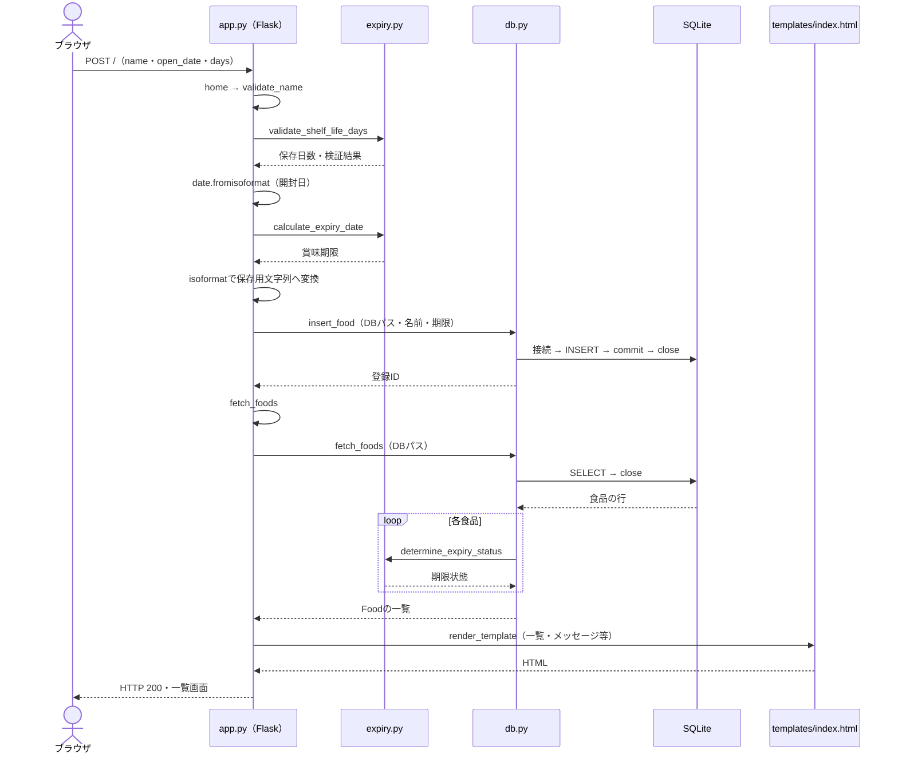

# 賞味期限管理アプリの設計

## 1. アプリの概要

食品の開封日と保存日数から賞味期限を計算し、登録・編集・削除・一覧表示を行うFlaskアプリです。
期限切れ・期限間近の食品へのメール通知と、AIによる確認ポイントの表示も実装しています。
一つのアプリ内で担当を分ける、シンプルなモノリシック構成を採用しています。
画面・期限ルール・保存・外部API通信を分け、変更箇所を見つけやすく、個別にテストしやすくします。

## 2. ファイル構成

主要なソース・文書を示します。実行時のDB・ログ・キャッシュと既存のバックアップは省略しています。

```text
kigenkanri-flask/
├── app.py                       # HTTP・Flask CLI・設定の受渡し
├── expiry.py                    # 期限計算・状態判定・日付関連の検証
├── db.py                        # SQLite接続・食品の読み書き・Foodデータ
├── notifications.py             # 通知対象抽出・本文作成・メール送信
├── ai_guidance.py               # AIへの依頼文・クライアント・ガイダンス生成
├── rag.py                       # 参考情報JSONの読込・食品名の完全一致検索
├── knowledge/food_guidance.json # 食品の参考情報
├── templates/index.html         # 入力フォーム・一覧・通知とAIの画面
├── tests/                       # 単体テスト・HTTPとCLIの結合テスト
├── run_notification.ps1         # 定期実行用の通知CLI起動
├── requirements.txt             # 使用ライブラリとバージョン
├── pytest.ini                   # テスト対象・キャッシュ先
├── .gitignore                   # DB・秘密情報・生成ファイルの除外
├── README.md                    # アプリの背景と使い方
├── ARCHITECTURE.md              # 現在の設計（本書）
└── docs/refactoring-report-2026-10-25.md # 改修時の詳細記録
```

## 3. モジュールの依存関係

矢印は呼び出す側から利用する側へ向かいます。通知からDBへの矢印は型の参照で、DB操作ではありません。



## 4. 食品登録の処理フロー

以下は登録成功時の流れです。名前と保存日数を検証し、開封日の変換・期限計算に成功してから保存します。



入力エラー時は保存せず、既存の一覧とエラーを表示します。登録時はPOSTへの応答としてHTMLを返します。

## 5. 設計上の重要な判断

- **期限計算の分離**：FlaskやDBを使わずに計算・検証でき、基準日を指定して境界値を確認できます。
  昨日以前は期限切れ、今日〜3日後は期限間近、4日後以降は通常。不正な保存済み日付は日付エラーです。
- **DB処理の分離**：SQLと接続管理を集め、例外時も接続を閉じます。書込成功時は確定、失敗時は取消します。
  DBパスを引数で渡すため、テスト用DBへ切り替えられます。一覧取得時の状態付与はexpiry.pyに任せます。
- **通知手順の共通化**：画面のボタンとCLIが同じnotify_foodsを使い、対象抽出・送信の手順のずれを防ぎます。
  リダイレクトやCLIの終了コードなど、入口ごとの応答処理はapp.pyに残します。
- **小規模な構成の維持**：機能と規模に合わせ、マイクロサービス化や共通基底クラスは導入していません。
  app.pyのinit_dbとfetch_foodsは設定を渡す窓口とし、下位モジュールからapp.pyを参照させません。

## 6. 今後の注意点

- **RAG**：読込・検索とAIへの参考情報の受渡しはテストされていますが、Web画面からは未接続です。
- **DB初期化**：python app.pyではinit_dbを実行します。Flask CLIでは自動初期化しないため、事前の初期化が必要です。
  既存のfoodsテーブルと列を維持しています。標準のdatabase.dbは実行時の作業ディレクトリを基準にします。
- **外部サービス**：改修時のテストは偽物のAPIを使用。実メール配信・実AI応答・タスクスケジューラ起動は未検証です。
  メールはRESEND_API_KEY・SENDER_EMAIL・RECIPIENT_EMAIL、AIはOPENAI_API_KEYを環境変数から取得します。
- **既存の制約**：FlaskアプリとResendのAPIキーはグローバルな状態を使います。複数設定の同時利用には再検討が必要です。
  日付は実行ホストのdate.todayを使います。通知の重複防止・再送は未実装で、今後の検討事項です。

## 7. 詳細報告書

調査結果、関数の移動記録、当時のテスト結果、コード例、初心者向けの物語は以下に保存しています。

[リファクタリング詳細報告書](docs/refactoring-report-2026-10-25.md)
