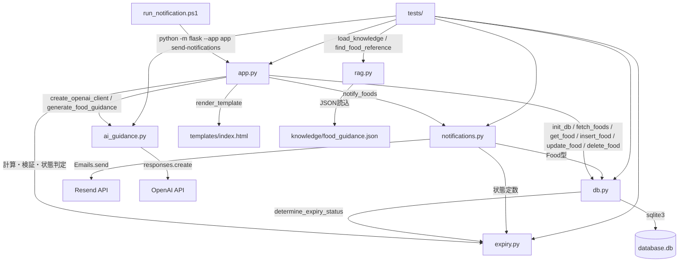
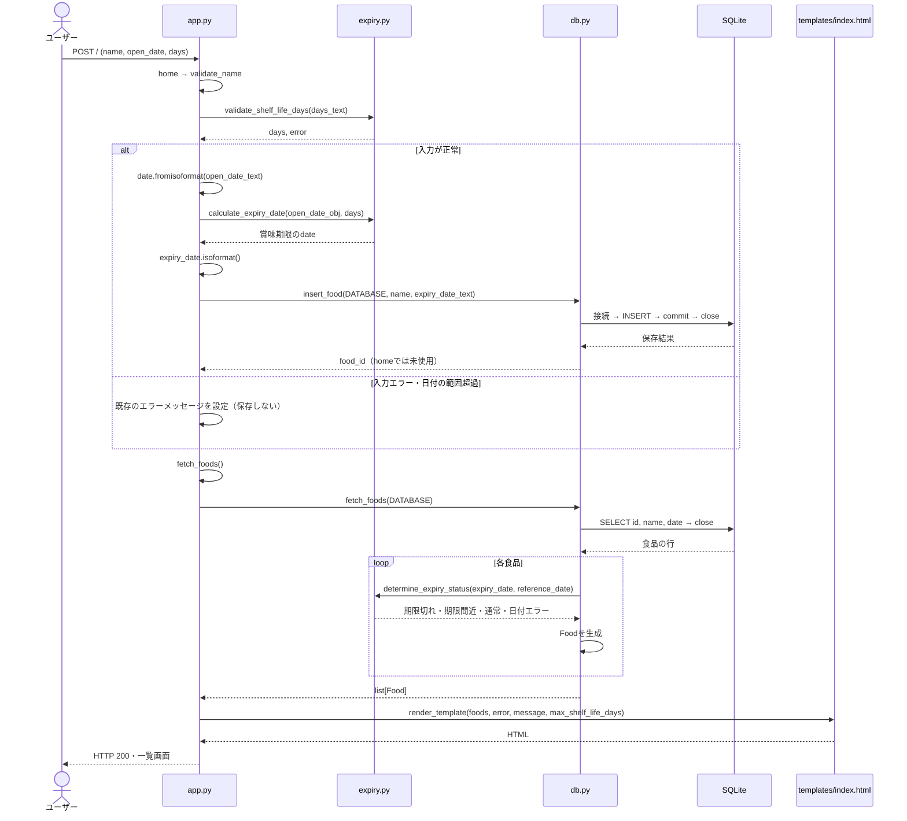

# 賞味期限管理アプリ：構成改善の調査・実装報告

調査・検証日：2026年10月25日。対象はこの作業フォルダーの実ファイル。
変更前の行番号はコミット `9e2e63a5c235fce225a6b0681e70513118b4dfb1` の内容に対応する。
例えば `git show 9e2e63a:app.py` で確認できる。以下の「旧」はその版、「新」は今回の作業後を指す。
GitHubへのpushやデプロイは行っていない。

## 1. 変更前のファイル構成

```text
kigenkanri-flask/
├── app.py                       # Flask、期限計算、SQL、通知
├── ai_guidance.py               # OpenAIクライアントとガイダンス生成
├── rag.py                       # JSON読込と食品名による参考情報検索
├── knowledge/food_guidance.json # 卵の参考情報
├── templates/index.html         # 登録・一覧・編集・削除・通知・AI表示
├── tests/
│   ├── test_app.py              # HTTP、DB、期限、通知、CLI、AI画面
│   ├── test_ai_guidance.py      # プロンプト、応答、設定
│   ├── test_rag.py              # 検索、JSON、プロンプトへの参考情報の受渡し
│   └── test_app.py.bak          # 未追跡のバックアップ（変更しない）
├── run_notification.ps1         # 定期実行用のFlask CLI起動
├── requirements.txt            # Flask、pytest、resend、openaiの固定バージョン
├── README.md                   # 背景、使い方、既存の設計説明
└── .gitignore                  # DB、環境変数ファイル、キャッシュ、ログを除外
```

ローカルにはGit管理外の `database.db`、`scheduler.log`、`__pycache__/`、
`.pytest_cache/`、`pytest-cache-files-qyoku8o0/`、`pytest-cache-files-xsnm7vay/` も存在する。
DBは読み取り専用接続でスキーマを確認した。`foods` の列は `id INTEGER PRIMARY KEY`、
`name TEXT NOT NULL`、`date TEXT NOT NULL`。食品の実データを書き換える調査はしていない。
ログやバイトコードはアプリのソースではない。既存キャッシュにはアクセス拒否があり、内容の全読込はできていない。
`.git/` はバージョン管理情報であり、アプリの実装には含めない。

### 旧app.pyの全関数・クラスと責任

| 旧位置 | 名前 | 責任・呼び出す処理 |
| --- | --- | --- |
| app.py:46 | `Food` | 一覧と通知で使う食品データのdataclass |
| app.py:53 | `get_db_connection` | Flask設定を読み、SQLiteに接続 |
| app.py:57 | `init_db` | 接続→テーブル作成→commit→close |
| app.py:73 | `calculate_expiry_date` | 開封日＋保存日数 |
| app.py:77 | `determine_expiry_status` | ISO日付読込、基準日との差、状態判定 |
| app.py:97 | `build_notification_email` | 件名と本文を作成 |
| app.py:117 | `send_notification_email` | 本文作成→`resend.Emails.send` |
| app.py:139 | `extract_notification_targets` | 状態から通知対象を抽出 |
| app.py:154 | `fetch_foods` | 接続→SELECT→状態判定→`Food`生成 |
| app.py:185 | `render_home_with_error` | 食品取得→エラー付きHTML、HTTP 400 |
| app.py:194 | `validate_name` | 名前の前後空白除去、空欄確認 |
| app.py:201 | `validate_iso_date` | 編集時の日付検証 |
| app.py:209 | `validate_shelf_life_days` | 数字、整数変換、1〜3650の検証 |
| app.py:225 | `home` | フォーム→検証→期限計算→INSERT→一覧HTML |
| app.py:266 | `send_notifications` | 設定確認→食品取得→対象抽出→送信→リダイレクト |
| app.py:308 | `send_notifications_command` | 同じ通知処理→標準出力・終了コード |
| app.py:338 | `delete_food` | DELETE→リダイレクト |
| app.py:351 | `edit_food` | 名前・日付検証→UPDATE、またはエラーHTML |
| app.py:375 | `show_ai_guidance` | SELECT→状態判定→AIクライアント作成→生成→HTML |

起動時は旧 `app.py:424` の `init_db()` からテーブルを作り、その後 `app.run(debug=True)`。
HTTPの入口は `/`（GET/POST）、`/notifications/send`（POST）、
`/delete/<int:food_id>`（POST）、`/edit/<int:food_id>`（POST）、
`/ai-guidance/<int:food_id>`（POST）。CLIは `send-notifications`。

外部処理の実際のつながりは次のとおり。

* Flaskは旧 `app.py:13` で読み込み、ルーティングとテンプレートに使用。
* SQLiteは旧 `app.py:53` の接続関数経由で各ルートや初期化から使用。
* メールは旧 `send_notification_email` → `resend.Emails.send`（旧 `app.py:136`）。
  APIキーは環境変数→Flask設定→モジュール読込時の `resend.api_key`（旧 `app.py:24`）。
* AIは旧 `show_ai_guidance` → `ai_guidance.create_openai_client`（ai_guidance.py:65）→
  `generate_food_guidance`（:40）→`build_food_guidance_prompt`（:6）→`client.responses.create`（:54）。
  APIキーは `OPENAI_API_KEY` から読む（:66）。
* `rag.find_food_reference`（rag.py:4）は辞書の完全一致検索、`load_knowledge`（:11）はJSON読込。
  `app.py` と `ai_guidance.py` は `rag.py` をimportしていない。
  参考情報を `generate_food_guidance(reference=...)` に渡す経路はテストにはあるが、画面にはない。

## 2. 発見した設計上の問題

| 根拠（旧版） | 問題 | 今回の対応 |
| --- | --- | --- |
| app.py:225、:351、:375 | HTTP、日付ルール、SQL、外部APIの手配が同じファイルに集中 | HTTPを残し、期限・SQL・通知を分離 |
| app.py:53 | DB接続だけでもグローバルなFlaskアプリ設定に依存 | DBパスを関数の引数にする |
| app.py:57、:154、:243、:338、:361、:375 | connect、execute、commit、closeの繰り返し。途中で例外になるとcloseに到達しない | db.pyで接続管理とSQLを集約 |
| app.py:266、:308 | 通知対象なし・送信の手順がHTTPとCLIで重複 | `notifications.notify_foods` を共通利用 |
| app.py:24、:267、:309 | 設定確認は実行時だが、SDKのキー設定はimport時に一度だけ | 実際に通知する直前に渡されたキーを設定 |
| tests/test_app.py:201、:532、:1122 | Flask結合テストに期限・通知の単体テストが混在 | test_expiry.py、test_notifications.pyへ移動 |
| tests/test_app.py:12、:940 | グローバル設定を直接変更して元に戻していない | conftest.pyのmonkeypatchで毎回復元 |
| tests/test_app.py:702 | 送信元と送信先はテスト設定するが、APIキーは実行環境に依存 | ダミーAPIキーも明示 |
| README.mdの「通知機能との連携」 | メール未連携という説明が実装より古い | READMEから本報告へ案内し説明を訂正 |

`tests/test_app.py.bak` の286、533、1123行にはマージ競合マーカーが残っている。
拡張子が `.bak` なのでpytestの収集対象ではない。ユーザーの既存ファイルとして保持した。
通知本文に似た内容を確認するテストもあるが、本文の完全一致・項目確認・順序確認は意味が異なるため削除していない。

## 3. 変更後のファイル構成

```text
kigenkanri-flask/
├── app.py                       # FlaskのHTTP・CLI、設定の受渡し
├── expiry.py                    # 期限計算・状態判定・日付と保存日数の検証
├── db.py                        # SQLite接続・CRUD、Foodデータ
├── notifications.py             # 対象抽出・本文・送信、共通通知手順
├── ai_guidance.py               # 既存のAI処理を維持
├── rag.py                       # 既存の検索処理を維持
├── knowledge/food_guidance.json # 変更なし
├── templates/index.html         # 変更なし
├── tests/
│   ├── conftest.py              # 設定復元、一時DB、外部通信ガード
│   ├── test_app.py              # HTTP・CLIの結合テスト
│   ├── test_expiry.py           # 期限の単体テスト
│   ├── test_db.py               # CRUD・既存スキーマ互換・更新失敗
│   ├── test_notifications.py    # 対象抽出・本文・送信の単体テスト
│   ├── test_ai_guidance.py      # 変更なし
│   ├── test_rag.py              # 変更なし
│   └── test_app.py.bak          # 既存のまま
├── pytest.ini                  # テスト対象とキャッシュ先を明示
├── run_notification.ps1         # 変更なし
├── requirements.txt             # 変更なし
├── README.md
├── ARCHITECTURE.md               # 本報告
└── .gitignore
```

単一プロセスで動くモノリスを維持した。サービス層のクラス、リポジトリ基底クラス、
Blueprint、アプリファクトリなどは追加していない。
DBは取得した行に期限状態を付けるため `expiry.py` に依存する。
小規模アプリなので、この短い変換のためだけに別のサービスファイルは設けなかった。
`Food` も食品のDB入出力に近い `db.py` に置き、独立したmodels.pyは増やしていない。
通知は `Food` の型を参照するがDB操作はしない。下位モジュールがapp.pyをimportする逆向きの依存はない。

## 4. 変更したファイルと関数

| 元の処理 | 移動先・変更後の位置 | 理由 |
| --- | --- | --- |
| app.py:73 `calculate_expiry_date` | expiry.py:22 | HTTPなしで日付計算できる |
| app.py:77 `determine_expiry_status` | expiry.py:26 | 状態の規則を一か所にする |
| app.py:201 `validate_iso_date` | expiry.py:46 | 日付の検証を期限ルールの近くに置く |
| app.py:209 `validate_shelf_life_days` | expiry.py:54 | 上限値と検証を同じファイルに置く |
| app.py:46 `Food` | db.py:11 | SQLの行を扱いやすいデータにする |
| app.py:53 `get_db_connection` | db.py:18 | DBパスを明示的に受け取る |
| app.py:57 `init_db` | db.py:22 | 同じスキーマを維持して初期化 |
| app.py:154 `fetch_foods` | db.py:33 | SQLとFood生成を集約 |
| app.py:375内のSELECT | db.py:44 `get_food` | AIルートからSQLを除去 |
| app.py:225内のINSERT | db.py:51 `insert_food` | 登録処理を単独で呼べる |
| app.py:351内のUPDATE | db.py:59 `update_food` | 編集時の保存を集約 |
| app.py:338内のDELETE | db.py:67 `delete_food` | 削除時の保存を集約 |
| app.py:97 `build_notification_email` | notifications.py:11 | 表示処理からメール形式を分離 |
| app.py:117 `send_notification_email` | notifications.py:31 | SDKの呼出箇所を集約 |
| app.py:139 `extract_notification_targets` | notifications.py:53 | 通知条件を一か所にする |
| HTTP・CLI内の抽出→送信 | notifications.py:68 `notify_foods` | 両方から同じ手順を呼ぶ |

`app.py:38` の `init_db()` と `:43` の `fetch_foods()` は、アプリ設定のDBパスを渡す短い窓口として残した。
既存の起動方法やテストからの呼出しも保てる。SQLは含まない。
`validate_name`（新app.py:57）はフォーム文字列の整形としてapp.pyに残した。
`home`（:65）、`send_notifications`（:99）、`send_notifications_command`（:121）、
`delete_food`（:145）、`edit_food`（:152）、`show_ai_guidance`（:167）のルート名・URLも維持した。

DBの `with closing(get_db_connection(database)) as conn, conn:` は二つの後始末を行う。
内側の `conn` は成功時commit、例外時rollback、外側の `closing` は必ずcloseする。
SQLiteの接続コンテキストだけではcloseされないため、両方を使っている。
SQLの `?` プレースホルダーも維持し、食品名をSQL文字列に直接埋め込まない。

APIキーをコードに追加していない。メール設定は従来どおり環境変数からFlask設定へ、
AI設定は `ai_guidance.create_openai_client()` で環境変数から読む。
Resend SDKのグローバルなapi_keyの使用自体は既存方式を維持した。

## 5. 依存関係図・処理フロー図

### A. ファイル・モジュールの依存関係

矢印は「呼び出す／利用する」方向。参考情報の読込はテストで使われており、画面からの依存線はない。



`app.py` 内のAI APIErrorとResendErrorの捕捉は、失敗をHTTPメッセージやCLI終了コードへ変換するために残る。
AI処理・メール送信の実装はそれぞれの担当モジュールにある。

### B. 食品登録のシーケンス

登録の成功時も従来どおり同じリクエストでHTMLを返す。POST後にリダイレクトする変更はしていない。



編集の入力エラーはHTTP 400、登録の入力エラーは従来どおりHTTP 200。
登録の正常系だけに統一するなど、既存のHTTP動作を変更する整理はしていない。

### ファンキーなおばあちゃんのスーパー

おばあちゃんは、キラキラのサングラスでスーパーを経営しています。
前は受付の人が、お客さんのお話を聞きながら、日付を計算し、倉庫へ走り、お手紙まで書いていました。
そこでおばあちゃんは言いました。「お仕事に、担当を決めよう！」
お店は一つのまま。それぞれが得意な仕事を受け持ちます。

**受付係：app.py。** お客さんの用紙を受け取り、担当者にお願いし、画面を返します。
受付で必要な処理の順番が読めるように、`home()` はここに残しました。

```python
# app.py:71付近（実装の抜粋）
name, error = validate_name(request.form.get("name", ""))
open_date_text = request.form.get("open_date", "")
days_text = request.form.get("days", "").strip()
```

`request.form` は「お客さんが書いた用紙」。`name`、`open_date`、`days` は用紙の欄の名前です。
テンプレートにも同じ `name="..."` があるので、欄の名前を勝手に変えてはいけません。

**日付の先生：expiry.py。** 「開けた日から3日たったら何日？」に答えます。
旧app.pyの `calculate_expiry_date`、`determine_expiry_status` と日付関連の検証を移しました。
日付の先生は、お客さんの画面も倉庫の場所も知る必要がありません。

```python
# expiry.py:22（実装）
def calculate_expiry_date(open_date, shelf_life_days):
    return open_date + timedelta(days=shelf_life_days)
```

**倉庫係：db.py。** 食品の名札をしまったり、取り出したりします。
旧 `get_db_connection`、`init_db`、`fetch_foods` とルート内のSQLをここへ移しました。
`Food` は倉庫から受け取る名札です。状態の判定は日付の先生にお願いしています。

```python
# db.py:51（実装の抜粋。withを抜けるとcommitとclose）
def insert_food(database, name, expiry_date):
    with closing(get_db_connection(database)) as conn, conn:
        cursor = conn.execute(
            "INSERT INTO foods (name, date) VALUES (?, ?)", (name, expiry_date)
        )
        return cursor.lastrowid
```

`database` は「どの倉庫を使うか」。テストでは小さな練習用倉庫を渡します。
本物の倉庫を触らずに練習できることが、引数で渡す設計の良さです。

**お知らせ係：notifications.py。** 確認が必要な食品だけを選び、お手紙を書いて送ります。
旧 `extract_notification_targets`、`build_notification_email`、`send_notification_email` を移しました。
画面のボタンでも毎朝の定期実行でも、同じ `notify_foods()` を使います。

```python
# notifications.py:68（実装の抜粋）
targets = extract_notification_targets(foods)
if not targets:
    return "通知対象の食品はありません"

resend.api_key = api_key
send_notification_email(
    targets,
    sender_email=sender_email,
    recipient_email=recipient_email,
)
```

**ものしり相談員：ai_guidance.py。** AIに確認ポイントを聞く人は、すでに別室にいました。
だから部屋を作り直す必要はありません。受付からSQLだけを倉庫係へ移しました。
`rag.py` は参考資料を探す本棚係です。いまは練習用テストから使われ、受付とはまだつながっていません。

```python
# ai_guidance.py:54（既存の実装）
response = client.responses.create(
    model="gpt-5.6-luna",
    input=prompt,
)
```

**importは、担当者の連絡先を教えてもらうこと。** ファイルをコピーする命令ではありません。

```python
# app.py:11、:13のimportから抜粋
import db
from expiry import calculate_expiry_date

# app.py:79〜82の実装から抜粋
expiry_date = calculate_expiry_date(open_date_obj, days)
expiry_date_text = expiry_date.isoformat()
db.insert_food(app.config["DATABASE"], name, expiry_date_text)
```

`import db` なら `db.insert_food(...)` と担当者名を付けて呼びます。
`from expiry import calculate_expiry_date` なら、その関数名を直接呼べます。

**牛乳を登録する旅。** 受付 `home()` が用紙を読み、日付の先生に期限を計算してもらい、
倉庫係の `insert_food()` に保存を頼みます。次に受付の `fetch_foods()` が倉庫係の
`db.fetch_foods()` を呼び、日付の先生が各食品の状態を判定します。最後にHTMLが一覧を描きます。

```python
# 実際の関数を使った、日付の先生の練習例
from datetime import date
from expiry import calculate_expiry_date, determine_expiry_status

limit = calculate_expiry_date(date(2026, 7, 2), 3)
assert limit.isoformat() == "2026-07-05"
assert determine_expiry_status(limit.isoformat(), date(2026, 7, 2)) == "期限間近"
```

**今後の仕事の置き場所。** 日数ルールならexpiry.py、保存・検索ならdb.py、
手紙の文章ならnotifications.py、AIへの依頼文ならai_guidance.py、
参考情報の検索ならrag.py、URLやフォームの受取ならapp.py、見た目ならtemplates/です。
例えば、将来「期限間近の日数を変更する」作業では、まず現在の定数と境界値テストを確認します。
今回は値を変更していません。

```python
# expiry.py:7（現在の実装）
EXPIRING_SOON_DAYS = 3

# db.py:44の既存関数。画面以外の処理からも再利用できる
food = db.get_food("練習用.db", 1)  # DBを初期化してから使う例
```

## 6. テスト実行結果

実行コマンドは `python -m pytest -q`。

| 段階 | 結果 |
| --- | --- |
| 変更前 | 78 passed in 8.03s |
| 期限計算分離後 | 78 passed in 5.64s（`-x`付きの確認） |
| DB分離後 | 78 passed in 5.74s |
| 通知分離直後 | 6 failed, 72 passed。挿入した日本語メッセージがPowerShell→Pythonのパイプで `?` に変換されていた |
| UTF-8での修正・テスト整理・追加後 | 100 passed in 2.20s |
| 共通通知手順のテスト追加後・最終 | **102 passed in 1.85s** |

既存70個のテスト関数をすべて保持した。パラメーター展開による変更前の実行件数は78件。
元の期限関数4個と通知関数3個はPythonのASTを比較し、実装が変わっていないことも確認した。

検証した主な内容：

* 昨日、今日、1・2・3・4日後の境界（test_expiry.py:8）。不正日付は「日付エラー」（:22）。
* 月またぎ・うるう年（:28）、保存日数の空欄・0・負数・文字・上限超過・非常に長い数値、1と3650（:33、:38）。
* フォーム経由の登録・編集・削除、入力エラー時の非保存、日付オーバーフロー（test_app.py:55、:65、:77、:149）。
* 元のスキーマと既存IDの保持、初期化の繰り返し、次の連番（test_db.py:10）。
* FlaskコンテキストなしのCRUD、SQLに見える食品名もデータとして保存（test_db.py:32）。
* 書込失敗時の既存データ保持と、続く書込の成功（test_db.py:46）。
* 通知対象・除外・順序、メール全文と送信引数、空対象、実行時APIキー（test_notifications.py）。
* HTTP/CLIの設定不足、対象なし、成功、ResendError、CLI終了コード（test_app.py:505以降）。
* AIの対象条件、存在しない食品、APIError・ValueError、画面表示（test_app.py:257以降）。
* AIプロンプト・空応答・タイムアウト設定・参考情報（既存test_ai_guidance.py、test_rag.py）。

通常の制限付き実行では、既存キャッシュの走査とWindowsの一時ディレクトリ
`pytest-of-sawas` にアクセス拒否が発生した。テストの収集先を `tests` に限定し、
キャッシュを別の場所にしたうえで、一時ディレクトリの制約がある実行は承認されたサンドボックス外実行で検証した。
途中のアクセス拒否はアプリのassertion失敗とは別の実行環境上の問題。
`.pytest_cache_local/` と、調査時に使った `.test-runs/` はGit管理から除外した。

`tests/conftest.py:11` は設定を復元し、実際のResend送信・OpenAIクライアント作成をガードする。
個々のテストが偽物に置き換えたAPIを使うため、本物のAPIキーは不要。
実際のメール配信、OpenAIの応答、Windowsタスクスケジューラによる起動は実施していない。
外部サービスの疎通・APIキーやモデルの有効性まで成功したとは判断できない。

`run_notification.ps1` は変更なし。PowerShell構文解析エラーなし。
20行目の `python -m flask --app app send-notifications` という入口を維持し、
同じCLIの正常・異常終了をpytestで検証した。メール実送信を伴うスクリプト全体の実行はしていない。

`database.db` の変更前後のSHA-256は一致：

```text
11B68EDDBEF0D7AEDB6DD4EB345B81866034EFAB64B2264605C6668E4D4D5FAC
```

## 7. 今後の改善候補

今回の必須動作を維持するため、次は実装せず候補として残した。

* `rag.py` を画面のAI処理につなぐ場合は、知識ファイルがないときの扱いと検索条件を先に決める。
* CLIを初回起動に使う場合、DB初期化は従来どおり先に必要。将来は明示的な初期化コマンドを検討できる。
* 複数のFlaskアプリを同一プロセスで動かす必要が出たら、アプリファクトリを検討する。
* 通知重複防止・再送やログの設計は、実際の運用要件が決まってから追加する。
* 通知を複数アカウントで同時実行する要件が出たら、Resendのグローバルなキー設定方式を再検討する。
* 日付は従来どおり `date.today()`（実行ホストのローカル日付）。運用サーバーのタイムゾーンは別途確認する。
* HTTPとCLIの通知テストをそれぞれ別ファイルに整理する余地はあるが、機能変更は不要。
* バックアップファイル内の競合マーカーは、必要な内容を確認してから整理する。

## 8. 理解すべきPython・Flaskの知識

| 知識 | このアプリでの意味 |
| --- | --- |
| モジュールとimport | `.py` ごとに担当を分け、他ファイルの関数を使う |
| 関数・引数・戻り値 | DBの場所や基準日を渡し、結果を受け取る。隠れた設定への依存を減らせる |
| `date` と `timedelta` | 文字列から日付へ変換し、日数を足す |
| `None` とタプル | `(値, エラー)`、食品がないときの `None` など、結果の表し方 |
| dataclass | `Food` のID、名前、期限、状態をまとめる |
| `@app.route` | URLとPythonの関数を結び付ける |
| request / render_template / redirect | フォームを受け取り、HTMLを返し、別URLへ案内する |
| HTTP状態コード | 一覧表示200、リダイレクト302、編集等の不正入力400という既存の約束 |
| `with` と例外処理 | DBの確定・取消・切断を忘れない。外部APIの失敗を画面の言葉に変える |
| SQLのプレースホルダー | `?` の値を別に渡し、文字列をSQL命令として連結しない |
| fixture / monkeypatch / tmp_path | 毎回の準備・後始末、偽物への置換、練習用DBを用意する |
| 単体テストと結合テスト | 日付の先生だけを確認するテストと、受付から倉庫まで通して確認するテスト |
| 環境変数 | 秘密のキーをソースコードに書かず、実行環境から受け取る |

読み進める順番は、`app.py` の `home()` → `expiry.calculate_expiry_date()` →
`db.insert_food()` → `db.fetch_foods()` → `templates/index.html` がおすすめ。
